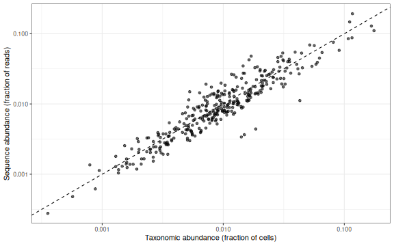
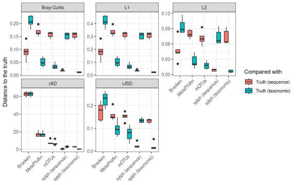
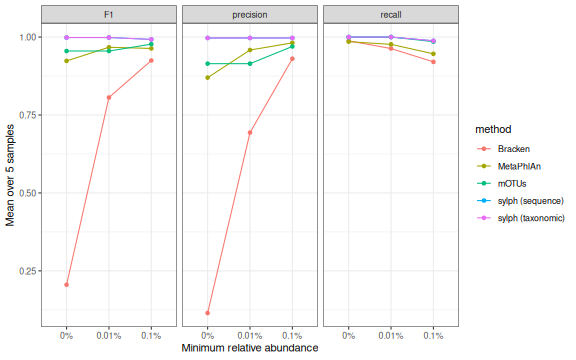
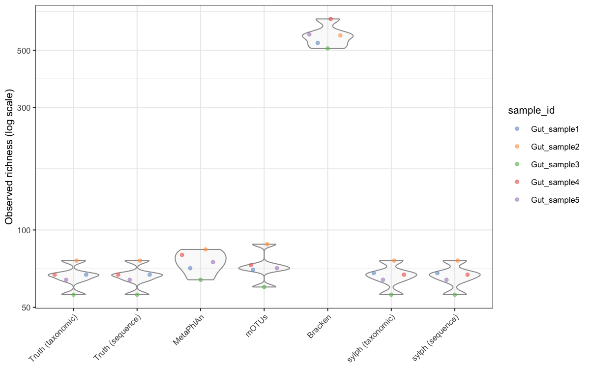
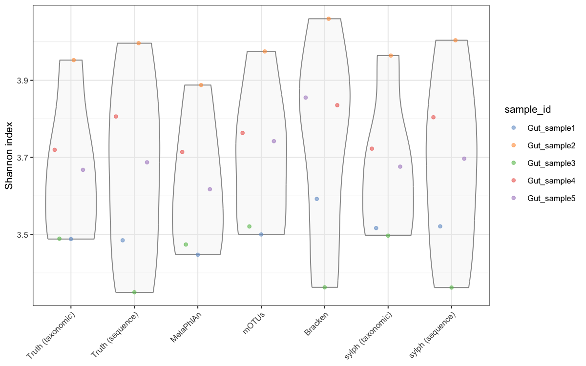
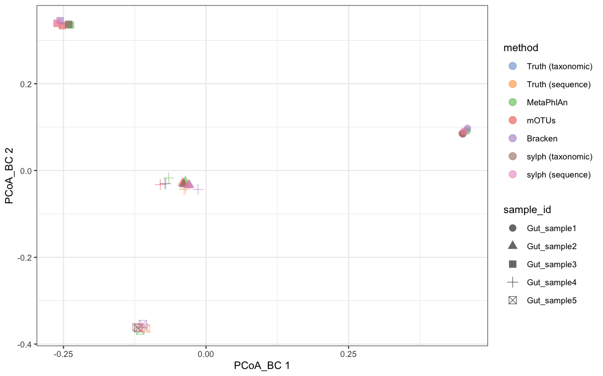

:::::::::::::::::::::::::::::::::::::: questions

- How close is each profiler to the known composition of the samples?
- Does the choice of profiler change alpha and beta diversity results?

::::::::::::::::::::::::::::::::::::::::::::::::

::::::::::::::::::::::::::::::::::::: objectives

- Combine the profiler outputs and the ground truth in one `TreeSummarizedExperiment`
- Explore the effect of abundance type on profiling output
- Calculate the distance between estimated profiles and the ground truth (Bray–Curtis, rJSD, L1, L2, rAD)
- Perform a precision–recall analysis of species detection
- Compare alpha diversity estimates among profilers
- Compare beta diversity among profilers with PCoA and PERMANOVA

::::::::::::::::::::::::::::::::::::::::::::::::


::::::::::::::::::::::::::::::::::::: instructor

Timing: about 15 min on loading the data and the ground-truth comparison, 30 min on alpha diversity, 30 min on beta diversity. Alternate short theory explanations of each metric with the exercises.

The comparison follows Sun *et al.* (2021), <https://doi.org/10.1038/s41592-021-01141-3>, Fig. 3–5. The numbers quoted in the text come from the organiser run of nf-core/taxprofiler 2.0.1 on the full five gut samples (see the instructor notes). If you regenerate the data, check that the numbers in the text still match.

::::::::::::::::::::::::::::::::::::::::::::::::

## Load packages and data


``` r
library(mia)
library(scater)
library(vegan)
library(readr)
library(dplyr)
library(tidyr)
library(ggplot2)
```


::::::::::::::::::::::::::::::::::::: callout

### Load `mia` before `dplyr`

`mia` has its own `left_join()`, `full_join()` and `inner_join()` functions for `TreeSummarizedExperiment` objects. If `mia` is loaded *after* `dplyr`, they mask the `dplyr` versions, and joining two data frames fails with *"Input includes an object that is not 'SummarizedExperiment'"*. Loading `mia` first, as above, avoids this. You can always call a specific version with `dplyr::left_join()`.

::::::::::::::::::::::::::::::::::::::::::::::::

The `data/` folder holds one table per profiler, two ground-truth tables and the sample metadata. All the profiler tables have the same layout: a `taxonomy_id` column, a `name` column, and one column per sample.

| File | Profiler and database | Taxonomy | Values |
|---|---|---|---|
| `metaphlan.tsv` | MetaPhlAn 4.1.1, `mpa_vJun23_CHOCOPhlAnSGB_202403` | NCBI | taxonomic abundance (%) |
| `motus.tsv` | mOTUs 3.1.0 | NCBI | marker-gene read counts |
| `bracken.tsv` | Kraken2 2.1.5 + Bracken 3.0.1, `k2_standard_08_GB_20260626` | NCBI | reads per species |
| `sylph_taxonomic.tsv`, `sylph_sequence.tsv` | sylph 0.7.0, GTDB R220 (`c200`) | GTDB R220 | taxonomic and sequence abundance (%) |
| `truth_taxonomic.tsv`, `truth_sequence.tsv` | ground truth from Sun *et al.* | NCBI, with GTDB R220 names | fractions |
| `ncbi_to_gtdb_r220.tsv` | mapping of the 95 truth species between NCBI and GTDB R220 | both | |
| `metadata.tsv` | sample information | | |

`taxonomy_id` is an NCBI taxonomy ID for the NCBI-based tools. For sylph it is the GTDB species name, and for the few taxa without an NCBI species ID (e.g. new MetaPhlAn SGBs) it is the tool's own identifier.

These tables were made from the per-sample output files of nf-core/taxprofiler. To make the same tables from your own pipeline results, see [From pipeline output to analysis tables](../learners/pipeline-to-tables.md).


``` r
read_profile <- function(file) {
  read_tsv(file, col_types = cols(taxonomy_id = col_character(), .default = col_guess()))
}

metadata  <- read_tsv("data/metadata.tsv")
truth_tax <- read_profile("data/truth_taxonomic.tsv")
truth_seq <- read_profile("data/truth_sequence.tsv")
metaphlan <- read_profile("data/metaphlan.tsv")
motus     <- read_profile("data/motus.tsv")
bracken   <- read_profile("data/bracken.tsv")
sylph_tax <- read_profile("data/sylph_taxonomic.tsv")
sylph_seq <- read_profile("data/sylph_sequence.tsv")
gtdb_map  <- read_tsv("data/ncbi_to_gtdb_r220.tsv", col_types = cols(.default = "c"))

samples <- metadata$sample_id
metadata
```

``` output
# A tibble: 5 × 6
  sample_id   community           n_species_truth read_pairs_raw read_pairs_qc
  <chr>       <chr>                         <dbl>          <dbl>         <dbl>
1 Gut_sample1 simulated human gut              67        9992084       9991772
2 Gut_sample2 simulated human gut              76        9996732       9996176
3 Gut_sample3 simulated human gut              56        9995889       9995356
4 Gut_sample4 simulated human gut              67        9991243       9990455
5 Gut_sample5 simulated human gut              64        9995965       9995479
# ℹ 1 more variable: kraken2_unclassified_pct <dbl>
```

## A first look at the outputs

Each profiler reports in its own units. Let's add up each table's columns:


``` r
outputs <- list(truth = truth_tax, MetaPhlAn = metaphlan, mOTUs = motus,
                Bracken = bracken, sylph = sylph_tax)
sapply(outputs, function(x) colSums(x[samples]))
```

``` output
                truth MetaPhlAn mOTUs Bracken    sylph
Gut_sample1 1.0000000  99.99999  6577 7633203  99.9999
Gut_sample2 1.0000000  99.99999  7478 7718950  99.9995
Gut_sample3 0.9999999  99.99999  6894 7879095  99.9999
Gut_sample4 1.0000000  99.99999  7514 7391640 100.0001
Gut_sample5 1.0000000  99.99999  6995 7670182  99.9999
```

The truth sums to 1 (fractions), MetaPhlAn and sylph to 100 (percent), and Bracken and mOTUs report counts. Bracken counts reads, while mOTUs counts reads mapped to its 10 marker genes, which is why its totals are so much smaller. Before comparing anything, we will convert all of them to relative abundances.

How many species does each tool report in each sample?


``` r
sapply(outputs, function(x) colSums(x[samples] > 0))
```

``` output
            truth MetaPhlAn mOTUs Bracken sylph
Gut_sample1    67        71    71     534    68
Gut_sample2    76        84    89     571    76
Gut_sample3    56        64    61     508    56
Gut_sample4    67        80    74     662    67
Gut_sample5    64        75    72     576    64
```

The samples contain 56–76 species. MetaPhlAn and mOTUs report a handful more, sylph almost exactly the right number, and Bracken more than 500 per sample.

::::::::::::::::::::::::::::::::::::: challenge

### Challenge 1: Where do Bracken's extra species come from?

1. Look at the `kraken2_unclassified_pct` column of `metadata`. What fraction of reads did Kraken2 leave unclassified?
2. Sort `bracken` by its abundance in `Gut_sample1` and look at rows 60–80 and the last few rows. How abundant are the species there?

:::::::::::::::::::::::: solution


``` r
metadata$kraken2_unclassified_pct
```

``` output
[1] 23.47 22.65 21.06 25.88 23.12
```

``` r
bracken_s1 <- bracken |>
  filter(Gut_sample1 > 0) |>
  arrange(desc(Gut_sample1)) |>
  select(name, Gut_sample1)
nrow(bracken_s1)
```

``` output
[1] 534
```

``` r
slice(bracken_s1, 60:75)
```

``` output
# A tibble: 16 × 2
   name                                      Gut_sample1
   <chr>                                           <dbl>
 1 Parabacteroides distasonis                      11446
 2 Parvimonas micra                                11091
 3 Streptococcus parasanguinis                     10858
 4 Paraprevotella clara                             9636
 5 Bifidobacterium sp. KRGSERBCFTRI                 9305
 6 [Clostridium] scindens                           8759
 7 Streptococcus cristatus                          8614
 8 Campylobacter hominis                            8142
 9 Fusobacterium periodonticum                      7461
10 Enterocloster bolteae                            6717
11 Phascolarctobacterium sp. Marseille-Q4147        4433
12 Eubacterium callanderi                           3005
13 Dorea formicigenerans                            2640
14 Haemophilus pittmaniae                           2235
15 Streptococcus sp. FDAARGOS_521                   2041
16 Clostridium taeniosporum                         1604
```

``` r
tail(bracken_s1)
```

``` output
# A tibble: 6 × 2
  name                       Gut_sample1
  <chr>                            <dbl>
1 Streptococcus danieliae             10
2 Legionella oakridgensis             10
3 Raoultibacter timonensis            10
4 Blautia hydrogenotrophica           10
5 Hominifimenecus sp. rT4P-3          10
6 Sanguibacter sp. TS_SC_8            10
```

1. About 21–26% of the reads were not classified. The simulation only used genomes present in the profilers' databases, but the Kraken2 database here is the *Standard-8* database, which is capped at 8 GB, so many k-mers of those genomes are missing.
2. Beyond the true species, Bracken reports hundreds of species with tens to a few thousand reads each, out of about 7.7 million classified reads. These are false positives: reads that share k-mers with related genomes in the database. They are the reason Kraken2/Bracken output is usually filtered by abundance or read count.

:::::::::::::::::::::::::::::::::

::::::::::::::::::::::::::::::::::::::::::::::::

## Same species, different names

The same organism can have a different name in each table. Here is NCBI taxonomy ID 33038:


``` r
bind_rows(truth = truth_tax, MetaPhlAn = metaphlan, mOTUs = motus, Bracken = bracken,
          .id = "source") |>
  filter(taxonomy_id == "33038") |>
  select(source, taxonomy_id, name)
```

``` output
# A tibble: 4 × 3
  source    taxonomy_id name                     
  <chr>     <chr>       <chr>                    
1 truth     33038       [Ruminococcus] gnavus    
2 MetaPhlAn 33038       Ruminococcus gnavus      
3 mOTUs     33038       [Ruminococcus] gnavus    
4 Bracken   33038       Mediterraneibacter gnavus
```

``` r
filter(sylph_tax, grepl("gnavus", name)) |> select(name, gtdb_lineage)
```

``` output
# A tibble: 1 × 2
  name                  gtdb_lineage                                            
  <chr>                 <chr>                                                   
1 Ruminococcus_B gnavus d__Bacteria;p__Bacillota_A;c__Clostridia;o__Lachnospira…
```

The NCBI-based tools use the names of their own NCBI taxonomy versions: *[Ruminococcus] gnavus* (2021, mOTUs), *Ruminococcus gnavus* (MetaPhlAn) and *Mediterraneibacter gnavus* (2026, Kraken2). The taxonomy ID stays the same, so we compare the NCBI-based tools by **taxonomy ID**, not by name. sylph uses GTDB R220, where the species is *Ruminococcus_B gnavus* in the phylum *Bacillota_A*, and there is no taxonomy ID to join on.

### Mapping sylph's GTDB names to NCBI

To put sylph in the same table as the others, we translate its GTDB species to NCBI taxonomy IDs with `ncbi_to_gtdb_r220.tsv`:


``` r
head(gtdb_map)
```

``` output
# A tibble: 6 × 6
  taxonomy_id ncbi_name    sun2021_name gtdb_r220_species gtdb_r220_species_by…¹
  <chr>       <chr>        <chr>        <chr>             <chr>                 
1 187327      Acidaminoco… Acidaminoco… Acidaminococcus … Acidaminococcus intes…
2 446660      Adlercreutz… Adlercreutz… Adlercreutzia eq… Adlercreutzia equolif…
3 732         Aggregatiba… Aggregatiba… Aggregatibacter … Aggregatibacter aphro…
4 239935      Akkermansia… Akkermansia… Akkermansia muci… Akkermansia muciniphi…
5 214856      Alistipes f… Alistipes_f… Alistipes finego… Alistipes finegoldii  
6 328814      Alistipes s… Alistipes_s… Alistipes shahii  Alistipes shahii      
# ℹ abbreviated name: ¹​gtdb_r220_species_by_name
# ℹ 1 more variable: evidence <chr>
```

Species without an NCBI equivalent keep their GTDB name as their ID:


``` r
add_ncbi_id <- function(sylph_table, gtdb_column = "gtdb_r220_species") {
  lookup <- select(gtdb_map, ncbi_id = taxonomy_id, gtdb = all_of(gtdb_column))
  sylph_table |>
    left_join(lookup, by = c("name" = "gtdb")) |>
    mutate(taxonomy_id = coalesce(ncbi_id, taxonomy_id)) |>
    select(-ncbi_id, -gtdb_lineage)
}

sylph_tax_ncbi <- add_ncbi_id(sylph_tax)
sylph_seq_ncbi <- add_ncbi_id(sylph_seq)

# sylph species that did not map to an NCBI taxonomy ID
filter(sylph_tax_ncbi, !grepl("^[0-9]+$", taxonomy_id)) |> select(taxonomy_id, name)
```

``` output
# A tibble: 1 × 2
  taxonomy_id                 name                       
  <chr>                       <chr>                      
1 Bifidobacterium sp959020155 Bifidobacterium sp959020155
```

All but one of sylph's species map to a truth species. The exception, *Bifidobacterium* sp959020155, is a false positive.

::::::::::::::::::::::::::::::::::::: challenge

### Challenge 2: Mapping by name

The mapping table has two GTDB columns. `gtdb_r220_species_by_name` is what you get by looking up the NCBI species name in GTDB, which places it with its type strain. `gtdb_r220_species` was checked against the genomes that were actually simulated.

1. For how many species do the two columns differ?
2. Map sylph's output with `gtdb_column = "gtdb_r220_species_by_name"`. How many sylph species now fail to map?
3. What would that do to sylph's apparent precision and recall?

:::::::::::::::::::::::: solution


``` r
filter(gtdb_map, gtdb_r220_species != gtdb_r220_species_by_name) |>
  select(ncbi_name, gtdb_r220_species_by_name, gtdb_r220_species)
```

``` output
# A tibble: 12 × 3
   ncbi_name                    gtdb_r220_species_by_name    gtdb_r220_species  
   <chr>                        <chr>                        <chr>              
 1 Clostridium botulinum        Clostridium_F botulinum      Clostridium cagae  
 2 Desulfovibrio piger          Desulfovibrio piger          Desulfovibrio pige…
 3 Faecalibacterium prausnitzii Faecalibacterium prausnitzii Faecalibacterium d…
 4 Finegoldia magna             Finegoldia magna             Finegoldia magna_H 
 5 Fusobacterium nucleatum      Fusobacterium nucleatum      Fusobacterium anim…
 6 Fusobacterium periodonticum  Fusobacterium periodonticum  Fusobacterium peri…
 7 Gardnerella vaginalis        Bifidobacterium vaginale     Bifidobacterium sw…
 8 Isoptericola variabilis      Pauljensenia variabilis      Isoptericola varia…
 9 Oxalobacter formigenes       Oxalobacter formigenes       Oxalobacter parafo…
10 Peptoniphilus harei          Peptoniphilus_A harei        Peptoniphilus_A ha…
11 Rothia mucilaginosa          Rothia mucilaginosa          Rothia sp001808955 
12 Streptococcus cristatus      Streptococcus cristatus      Streptococcus cris…
```

``` r
add_ncbi_id(sylph_tax, gtdb_column = "gtdb_r220_species_by_name") |>
  filter(!grepl("^[0-9]+$", taxonomy_id)) |>
  nrow()
```

``` output
[1] 13
```

1. 12 species. GTDB splits these NCBI species into several species, and the genome that was simulated is not in the same GTDB species as the type strain. For example, the *Fusobacterium nucleatum* genome belongs to *Fusobacterium animalis* in GTDB.
2. 13 species: the 12 split species plus the real false positive.
3. Each of the 12 would count as a false positive (the GTDB name sylph reported) **and** a false negative (the truth species it "missed"), even though sylph found the right genome. A name-based mapping across taxonomies can make a correct profiler look wrong.

:::::::::::::::::::::::::::::::::

::::::::::::::::::::::::::::::::::::::::::::::::

::::::::::::::::::::::::::::::::::::: instructor

How `gtdb_r220_species` was checked: for each of the 12 split species, sylph reported a GTDB species that had the same presence/absence pattern across the five samples as the truth species, abundances that differed by at most 0.15 percentage points in total across the five samples, and ANI ≥ 97% to the GTDB representative genome. So the simulated genome falls within that GTDB species cluster. This uses sylph's output, so it is not fully independent of sylph. The alternative is to look up the simulated genome accessions (from the read names) in the GTDB R220 metadata; see `data-prep/` in the lesson repository.

::::::::::::::::::::::::::::::::::::::::::::::::

## Combine everything in one `TreeSummarizedExperiment`

We now put the truth and all profiler outputs into one object. Each column is one *sample × method* combination, and each row is one taxon. We drop mOTUs' `-1` row (reads from species missing from its database, about 0.1–0.3% here), and convert every column to relative abundance so that it sums to 1.


``` r
methods <- c("Truth (taxonomic)", "Truth (sequence)", "MetaPhlAn", "mOTUs", "Bracken",
             "sylph (taxonomic)", "sylph (sequence)")

profiles <- bind_rows(
  "Truth (taxonomic)" = truth_tax,
  "Truth (sequence)"  = truth_seq,
  "MetaPhlAn"         = metaphlan,
  "mOTUs"             = filter(motus, taxonomy_id != "-1"),
  "Bracken"           = bracken,
  "sylph (taxonomic)" = sylph_tax_ncbi,
  "sylph (sequence)"  = sylph_seq_ncbi,
  .id = "method") |>
  select(method, taxonomy_id, name, all_of(samples)) |>
  pivot_longer(all_of(samples), names_to = "sample_id", values_to = "value") |>
  group_by(method, sample_id) |>
  mutate(relabundance = value / sum(value)) |>
  ungroup() |>
  mutate(column = paste(sample_id, method, sep = " | "))

profiles
```

``` output
# A tibble: 8,435 × 7
   method            taxonomy_id name      sample_id   value relabundance column
   <chr>             <chr>       <chr>     <chr>       <dbl>        <dbl> <chr> 
 1 Truth (taxonomic) 29391       Gemella … Gut_samp… 0.176        0.176   Gut_s…
 2 Truth (taxonomic) 29391       Gemella … Gut_samp… 0.00874      0.00874 Gut_s…
 3 Truth (taxonomic) 29391       Gemella … Gut_samp… 0.0540       0.0540  Gut_s…
 4 Truth (taxonomic) 29391       Gemella … Gut_samp… 0.00774      0.00774 Gut_s…
 5 Truth (taxonomic) 29391       Gemella … Gut_samp… 0            0       Gut_s…
 6 Truth (taxonomic) 1680        Bifidoba… Gut_samp… 0.0194       0.0194  Gut_s…
 7 Truth (taxonomic) 1680        Bifidoba… Gut_samp… 0.0278       0.0278  Gut_s…
 8 Truth (taxonomic) 1680        Bifidoba… Gut_samp… 0.0130       0.0130  Gut_s…
 9 Truth (taxonomic) 1680        Bifidoba… Gut_samp… 0.00250      0.00250 Gut_s…
10 Truth (taxonomic) 1680        Bifidoba… Gut_samp… 0.167        0.167   Gut_s…
# ℹ 8,425 more rows
```

Next, build the three parts of the object: the abundance matrix (`assay`), the column information (`colData`) and the row information (`rowData`):


``` r
# abundance matrix: taxa x (sample | method)
wide <- profiles |>
  select(taxonomy_id, column, relabundance) |>
  pivot_wider(names_from = column, values_from = relabundance, values_fill = 0)
abundance <- as.matrix(select(wide, -taxonomy_id))
rownames(abundance) <- wide$taxonomy_id

# one row per column of the matrix
col_info <- profiles |>
  distinct(column, sample_id, method) |>
  mutate(method = factor(method, levels = methods),
         profiler = sub(" \\(.*", "", method),
         abundance_type = ifelse(grepl("sequence", method) | method == "Bracken",
                                 "sequence", "taxonomic"),
         taxonomy = ifelse(grepl("sylph", method), "GTDB R220", "NCBI")) |>
  as.data.frame()
rownames(col_info) <- col_info$column

# one row per taxon: use the truth name where there is one
row_info <- profiles |>
  arrange(!grepl("Truth", method)) |>
  distinct(taxonomy_id, .keep_all = TRUE) |>
  transmute(taxonomy_id, name, in_truth = taxonomy_id %in% truth_tax$taxonomy_id) |>
  as.data.frame()
rownames(row_info) <- row_info$taxonomy_id
```


``` r
tse <- TreeSummarizedExperiment(
  assays  = list(relabundance = abundance),
  colData = DataFrame(col_info[colnames(abundance), ]),
  rowData = DataFrame(row_info[rownames(abundance), ]))
tse
```


``` output
class: TreeSummarizedExperiment 
dim: 1101 35 
metadata(0):
assays(1): relabundance
rownames(1101): 29391 1680 ... 45497 Bifidobacterium sp959020155
rowData names(3): taxonomy_id name in_truth
colnames(35): Gut_sample1 | Truth (taxonomic) Gut_sample2 | Truth
  (taxonomic) ... Gut_sample4 | sylph (sequence) Gut_sample5 | sylph
  (sequence)
colData names(6): column sample_id ... abundance_type taxonomy
reducedDimNames(0):
mainExpName: NULL
altExpNames(0):
rowLinks: NULL
rowTree: NULL
colLinks: NULL
colTree: NULL
```


``` r
table(tse$method, tse$abundance_type)
```


``` output
                   
                    sequence taxonomic
  Truth (taxonomic)        0         5
  Truth (sequence)         5         0
  MetaPhlAn                0         5
  mOTUs                    0         5
  Bracken                  5         0
  sylph (taxonomic)        0         5
  sylph (sequence)         5         0
```

## Sequence abundance versus taxonomic abundance

The ground truth gives both abundance types for the same community. If all genomes were the same size, the two would be identical:


``` r
truth_long <- truth_tax |>
  pivot_longer(all_of(samples), names_to = "sample_id", values_to = "taxonomic") |>
  inner_join(pivot_longer(truth_seq, all_of(samples), names_to = "sample_id",
                          values_to = "sequence"),
             by = c("taxonomy_id", "name", "gtdb_r220_species", "sample_id")) |>
  filter(taxonomic > 0)

ggplot(truth_long, aes(taxonomic, sequence)) +
  geom_abline(linetype = "dashed") +
  geom_point(alpha = 0.6) +
  scale_x_log10() + scale_y_log10() +
  labs(x = "Taxonomic abundance (fraction of cells)",
       y = "Sequence abundance (fraction of reads)") +
  theme_bw()
```



Species above the dashed line have larger genomes than average, so they contribute more reads per cell. Species below it have smaller genomes. Within a sample, the ratio of the two abundances is proportional to genome size:


``` r
truth_long |>
  mutate(ratio = sequence / taxonomic) |>
  group_by(name) |>
  summarise(relative_genome_size = median(ratio)) |>
  arrange(relative_genome_size) |>
  slice(c(1:3, (n() - 2):n()))
```

``` output
# A tibble: 6 × 2
  name                     relative_genome_size
  <chr>                                   <dbl>
1 Mycoplasma hominis                      0.242
2 Lancefieldella parvula                  0.567
3 Parvimonas micra                        0.598
4 Bacteroides intestinalis                2.19 
5 Blautia producta                        2.20 
6 Hungatella hathewayi                    2.74 
```

*Mycoplasma hominis* has a very small genome (about 0.7 Mb), so its share of the reads is about a quarter of its share of the cells. *Hungatella hathewayi* (about 7 Mb) is the opposite. A profiler that reports one type cannot be fairly judged against the other.

## How close is each profiler to the truth?

We measure the distance between each estimated profile and the truth with five measures, as in Sun *et al.* (2021):

| Measure | What it does |
|---|---|
| **Bray–Curtis** | Sum of absolute differences, scaled to 0–1. Dominated by abundant taxa |
| **L1** | Sum of absolute differences (Manhattan distance). Same ranking as Bray–Curtis for relative abundances |
| **L2** | Euclidean distance. Squares the differences, so a few large errors dominate |
| **rJSD** | Square root of the Jensen–Shannon divergence, a symmetric measure from information theory |
| **rAD** | Robust Aitchison distance: Euclidean distance after a centred log-ratio transform of the non-zero values. Compositionally aware, and gives rare taxa much more weight |


``` r
rjsd <- function(p, q) {
  m  <- (p + q) / 2
  kl <- function(a, b) sum(ifelse(a > 0, a * log(a / b), 0))
  sqrt(0.5 * kl(p, m) + 0.5 * kl(q, m))
}

rclr <- function(x) {
  out <- numeric(length(x))
  nonzero <- x > 0
  out[nonzero] <- log(x[nonzero]) - mean(log(x[nonzero]))
  out
}

distance_to_truth <- function(x, truth) {
  c(`Bray-Curtis` = as.numeric(vegdist(rbind(x, truth), method = "bray")),
    L1   = sum(abs(x - truth)),
    L2   = sqrt(sum((x - truth)^2)),
    rJSD = rjsd(x, truth),
    rAD  = sqrt(sum((rclr(x) - rclr(truth))^2)))
}
```

We compare each profiler against **both** truths, in every sample:


``` r
ab <- assay(tse, "relabundance")
```


``` r
comparisons <- expand_grid(sample_id = samples,
                           method = methods[-(1:2)],
                           truth = c("Truth (taxonomic)", "Truth (sequence)"))

distances <- comparisons |>
  rowwise() |>
  mutate(d = list(distance_to_truth(ab[, paste(sample_id, method, sep = " | ")],
                                    ab[, paste(sample_id, truth, sep = " | ")]))) |>
  unnest_wider(d) |>
  pivot_longer(`Bray-Curtis`:rAD, names_to = "measure", values_to = "distance")

ggplot(distances, aes(method, distance, fill = truth)) +
  geom_boxplot() +
  facet_wrap(~ measure, scales = "free_y") +
  labs(x = NULL, y = "Distance to the truth", fill = "Compared with") +
  theme_bw() +
  theme(axis.text.x = element_text(angle = 45, hjust = 1))
```




``` r
distances |>
  filter(measure == "Bray-Curtis") |>
  group_by(method, truth) |>
  summarise(mean_bray_curtis = round(mean(distance), 3), .groups = "drop") |>
  pivot_wider(names_from = truth, values_from = mean_bray_curtis)
```

``` output
# A tibble: 5 × 3
  method            `Truth (sequence)` `Truth (taxonomic)`
  <chr>                          <dbl>               <dbl>
1 Bracken                        0.092               0.209
2 MetaPhlAn                      0.169               0.05 
3 mOTUs                          0.157               0.034
4 sylph (sequence)               0.017               0.153
5 sylph (taxonomic)              0.155               0.011
```

With Bray–Curtis, L1, L2 and rJSD, the "winner" depends on the truth we choose:

- Compared with the **sequence** truth, Bracken (Bray–Curtis ≈ 0.09) beats MetaPhlAn and mOTUs (≈ 0.16).
- Compared with the **taxonomic** truth, MetaPhlAn (≈ 0.05) and mOTUs (≈ 0.03) beat Bracken (≈ 0.21).
- sylph reports both types, and each is closest to its own truth (≈ 0.01–0.02).

Neither ranking is "the" ranking. Each tool estimates a different quantity, and a benchmark is only fair if it compares like with like.

::::::::::::::::::::::::::::::::::::: challenge

### Challenge 3: Why is rAD different?

In the rAD panel, Bracken, MetaPhlAn and mOTUs are about the same distance from both truths, and Bracken is far worse than the others. Why? Hint: what does rAD do with rare taxa, and how many rare taxa does each profiler report?

:::::::::::::::::::::::: solution

rAD works on log-ratios, so a false positive at 0.001% counts as much as an error in a species at 10%. Bracken has around 500 low-abundance false positives per sample, MetaPhlAn and mOTUs a handful, and sylph almost none. The false positives dominate rAD and swamp the abundance-type effect. Sun *et al.* showed the same pattern, and that removing the false positives restores the dependence on abundance type.

:::::::::::::::::::::::::::::::::

::::::::::::::::::::::::::::::::::::::::::::::::

## Precision and recall

Distances combine *which* taxa are found with *how much* of each. Precision and recall look only at detection:

- **True positive (TP):** in the truth and detected. **False positive (FP):** detected but not in the truth. **False negative (FN):** in the truth but missed.
- **Precision** = TP / (TP + FP): how many of the detected taxa are real.
- **Recall** = TP / (TP + FN): how many of the real taxa were detected.
- **F1** = the harmonic mean of the two.

Both truth tables contain the same species, so this part does not depend on abundance type. Many false positives sit at very low abundance, so we also apply abundance thresholds:


``` r
truth_presence <- truth_tax |>
  pivot_longer(all_of(samples), names_to = "sample_id", values_to = "abundance") |>
  filter(abundance > 0) |>
  select(sample_id, taxonomy_id)

detection <- profiles |>
  filter(!grepl("Truth", method)) |>
  expand_grid(threshold = c(0, 0.0001, 0.001)) |>
  filter(relabundance > threshold) |>
  select(method, sample_id, threshold, taxonomy_id)

pr <- expand_grid(method = methods[-(1:2)], sample_id = samples,
                  threshold = c(0, 0.0001, 0.001)) |>
  rowwise() |>
  mutate(
    found = list(detection$taxonomy_id[detection$method == method &
                                       detection$sample_id == sample_id &
                                       detection$threshold == threshold]),
    true  = list(truth_presence$taxonomy_id[truth_presence$sample_id == sample_id]),
    TP = length(intersect(found, true)),
    FP = length(setdiff(found, true)),
    FN = length(setdiff(true, found))) |>
  ungroup() |>
  mutate(precision = TP / (TP + FP),
         recall    = TP / (TP + FN),
         F1        = 2 * precision * recall / (precision + recall))

pr |>
  group_by(method, threshold) |>
  summarise(across(c(TP, FP, FN, precision, recall, F1), \(x) round(mean(x), 2)),
            .groups = "drop")
```

``` output
# A tibble: 15 × 8
   method            threshold    TP    FP    FN precision recall    F1
   <chr>                 <dbl> <dbl> <dbl> <dbl>     <dbl>  <dbl> <dbl>
 1 Bracken              0       65.2 505     0.8      0.11   0.99  0.21
 2 Bracken              0.0001  63.6  28.2   2.4      0.69   0.96  0.81
 3 Bracken              0.001   60.8   4.8   5.2      0.93   0.92  0.92
 4 MetaPhlAn            0       65     9.8   1        0.87   0.99  0.92
 5 MetaPhlAn            0.0001  64.4   2.8   1.6      0.96   0.98  0.97
 6 MetaPhlAn            0.001   62.4   1.2   3.6      0.98   0.95  0.96
 7 mOTUs                0       66     6.4   0        0.91   1     0.96
 8 mOTUs                0.0001  66     6.4   0        0.91   1     0.96
 9 mOTUs                0.001   65     2     1        0.97   0.99  0.98
10 sylph (sequence)     0       66     0.2   0        1      1     1   
11 sylph (sequence)     0.0001  66     0.2   0        1      1     1   
12 sylph (sequence)     0.001   65.2   0.2   0.8      1      0.99  0.99
13 sylph (taxonomic)    0       66     0.2   0        1      1     1   
14 sylph (taxonomic)    0.0001  66     0.2   0        1      1     1   
15 sylph (taxonomic)    0.001   65.2   0.2   0.8      1      0.99  0.99
```


``` r
pr |>
  pivot_longer(c(precision, recall, F1), names_to = "score") |>
  mutate(threshold = factor(paste0(threshold * 100, "%"), levels = c("0%", "0.01%", "0.1%"))) |>
  ggplot(aes(threshold, value, colour = method, group = method)) +
  stat_summary(fun = mean, geom = "line") +
  stat_summary(fun = mean, geom = "point") +
  facet_wrap(~ score) +
  labs(x = "Minimum relative abundance", y = "Mean over 5 samples") +
  theme_bw()
```



Without a threshold, Bracken finds almost every true species (recall 0.99), but only about 1 in 9 of the species it reports is real (precision 0.11). A 0.1% threshold raises its precision to 0.93, at the cost of missing a few low-abundance species (recall 0.92). MetaPhlAn and mOTUs start with few false positives, and sylph has almost none.

::::::::::::::::::::::::::::::::::::: discussion

### Is sylph really that good?

sylph is close to perfect on these data. Before you choose it for your own study, think about why it does so well here:

- The genomes used to simulate the reads (or genomes ≥ 97% identical to them) are in its GTDB database. Real samples contain many species without a close reference genome.
- The reads are simulated, with no host DNA, contamination or sequencing artefacts.
- The GTDB names of 12 truth species were assigned with the help of sylph's own output (see Challenge 2).

The ranking of profilers on a benchmark depends on how the benchmark was built.

::::::::::::::::::::::::::::::::::::::::::::::::

## Alpha diversity

Alpha diversity summarises each sample with one number. We calculate three common indices with `mia::addAlpha()`:

- **Observed richness**: the number of taxa detected.
- **Shannon index**: combines richness and evenness, and weights taxa by their abundance.
- **Inverse Simpson index**: the "effective number" of dominant taxa, and the least sensitive to rare taxa.


``` r
tse <- addAlpha(tse, assay.type = "relabundance",
                index = c("observed", "shannon", "inverse_simpson"))

as.data.frame(colData(tse)) |>
  group_by(method) |>
  summarise(across(c(observed, shannon, inverse_simpson), \(x) round(mean(x), 2)))
```


``` output
# A tibble: 7 × 4
  method            observed shannon inverse_simpson
  <fct>                <dbl>   <dbl>           <dbl>
1 Truth (taxonomic)     66      3.66            24.4
2 Truth (sequence)      66      3.66            26.9
3 MetaPhlAn             74.8    3.63            23.2
4 mOTUs                 72.4    3.7             25.4
5 Bracken              570.     3.74            28.0
6 sylph (taxonomic)     66.2    3.68            24.8
7 sylph (sequence)      66.2    3.68            27.3
```


``` r
plotColData(tse, x = "method", y = "observed", colour_by = "sample_id") +
  scale_y_log10() +
  labs(x = NULL, y = "Observed richness (log scale)") +
  theme(axis.text.x = element_text(angle = 45, hjust = 1))

plotColData(tse, x = "method", y = "shannon", colour_by = "sample_id") +
  labs(x = NULL, y = "Shannon index") +
  theme(axis.text.x = element_text(angle = 45, hjust = 1))
```



Richness is very sensitive to the profiler: Bracken reports about 570 species per sample against 66 in the truth. The Shannon index changes much less, because the false positives are rare and contribute little to it.

Sun *et al.* found that the Shannon index is systematically higher for taxonomic than for sequence abundance. Is that the case for our five samples?


``` r
shannon_truth <- as.data.frame(colData(tse)) |>
  filter(grepl("Truth", method)) |>
  select(sample_id, method, shannon) |>
  pivot_wider(names_from = method, values_from = shannon)
shannon_truth

wilcox.test(shannon_truth$`Truth (taxonomic)`, shannon_truth$`Truth (sequence)`,
            paired = TRUE)
```


``` output
# A tibble: 5 × 3
  sample_id   `Truth (taxonomic)` `Truth (sequence)`
  <chr>                     <dbl>              <dbl>
1 Gut_sample1                3.49               3.48
2 Gut_sample2                3.95               4.00
3 Gut_sample3                3.49               3.35
4 Gut_sample4                3.72               3.81
5 Gut_sample5                3.67               3.69

	Wilcoxon signed rank exact test

data:  shannon_truth$`Truth (taxonomic)` and shannon_truth$`Truth (sequence)`
V = 6, p-value = 0.8125
alternative hypothesis: true location shift is not equal to 0
```

Here the two abundance types give similar Shannon values, and the test is far from significant. Note also that with 5 paired samples, the smallest p-value an exact Wilcoxon signed-rank test can return is 0.0625. Even a perfectly consistent difference could not reach p < 0.05.

::::::::::::::::::::::::::::::::::::: challenge

### Challenge 4: Richness after filtering

Apply the 0.1% threshold to the abundance matrix, recalculate observed richness, and compare it with the truth. Which profiler is affected most?

:::::::::::::::::::::::: solution


``` r
assay(tse, "filtered") <- ifelse(assay(tse, "relabundance") > 0.001,
                                 assay(tse, "relabundance"), 0)
tse <- addAlpha(tse, assay.type = "filtered", index = "observed", name = "observed_filtered")

as.data.frame(colData(tse)) |>
  group_by(method) |>
  summarise(observed = mean(observed), observed_filtered = mean(observed_filtered))
```


``` output
# A tibble: 7 × 3
  method            observed observed_filtered
  <fct>                <dbl>             <dbl>
1 Truth (taxonomic)     66                65  
2 Truth (sequence)      66                65.4
3 MetaPhlAn             74.8              63.6
4 mOTUs                 72.4              67  
5 Bracken              570.               65.6
6 sylph (taxonomic)     66.2              65.4
7 sylph (sequence)      66.2              65.4
```

Bracken drops from about 570 to about 66 species, close to the truth. MetaPhlAn drops from about 75 to 64, slightly below the truth, and mOTUs and sylph change little. Note that the threshold also removes true species below 0.1% (including from the truth itself), so a filtered richness is no longer the richness of the community.

:::::::::::::::::::::::::::::::::

::::::::::::::::::::::::::::::::::::::::::::::::

## Beta diversity

Beta diversity compares samples with each other. We calculate Bray–Curtis dissimilarities between all 35 columns and display them with a principal coordinates analysis (PCoA):


``` r
tse <- addMDS(tse, FUN = getDissimilarity, method = "bray",
              assay.type = "relabundance", name = "PCoA_BC", ncomponents = 2)

plotReducedDim(tse, "PCoA_BC", colour_by = "method", shape_by = "sample_id", point_size = 3)
```



The points form five tight groups, one per sample: the samples differ much more from each other than the profilers differ from each other. Within each group, the profiler still moves the point.

How much of the variation does each factor explain? PERMANOVA (`vegan::adonis2()`) partitions the dissimilarities between sample and method:


``` r
bray <- getDissimilarity(tse, method = "bray", assay.type = "relabundance")
col_df <- as.data.frame(colData(tse))

set.seed(2026)
adonis2(bray ~ sample_id + method, data = col_df, by = "margin", permutations = 999)
```


``` output
Permutation test for adonis under reduced model
Marginal effects of terms
Permutation: free
Number of permutations: 999

adonis2(formula = bray ~ sample_id + method, data = col_df, permutations = 999, by = "margin")
          Df SumOfSqs      R2       F Pr(>F)    
sample_id  4   6.2966 0.95432 4889.64  0.001 ***
method     6   0.2937 0.04451  152.03  0.001 ***
Residual  24   0.0077 0.00117                   
Total     34   6.5979 1.00000                   
---
Signif. codes:  0 '***' 0.001 '**' 0.01 '*' 0.05 '.' 0.1 ' ' 1
```

The sample explains about 95% of the variation (R²), and the method about 4.5%, which is small but clearly significant. PERMANOVA assumes the groups have a similar spread, so we check that with `betadisper()`:


``` r
anova(betadisper(bray, col_df$method))
```


``` output
Analysis of Variance Table

Response: Distances
          Df   Sum Sq  Mean Sq F value Pr(>F)
Groups     6 0.000232 3.86e-05  0.0107      1
Residuals 28 0.101079 3.61e-03               
```

The spread is the same for all methods (p ≈ 1), so the PERMANOVA result reflects a shift between methods rather than a difference in spread.

::::::::::::::::::::::::::::::::::::: discussion

### What does 4.5% mean for a real study?

Here the samples are very different from each other, so the profiler effect looks small. In a real study, the differences between your groups (e.g. patients and controls) may well be smaller than 4.5% of the variation. What would happen if half of your samples were profiled with one tool and half with another? What if one group's profiles were downloaded from a public resource made with a different database version?

::::::::::::::::::::::::::::::::::::::::::::::::

::::::::::::::::::::::::::::::::::::: keypoints

- Profilers report in different units (percent, read counts, marker-gene counts) and different taxonomies. Convert to relative abundance and map to one taxonomy before comparing them.
- Compare NCBI-based outputs by taxonomy ID, not by name. Mapping NCBI to GTDB by name can turn correct detections into false positives and false negatives.
- Sequence and taxonomic abundance differ because genome sizes differ, and the "best" profiler in a benchmark depends on which one is used as the truth.
- k-mer classifiers such as Kraken2/Bracken report many low-abundance false positives. Abundance thresholds raise precision at a small cost in recall.
- Richness is very sensitive to the profiler. The Shannon and inverse Simpson indices are more robust.
- In beta diversity, the profiler is a real, measurable source of variation. Don't mix profilers or databases within one analysis.

::::::::::::::::::::::::::::::::::::::::::::::::
